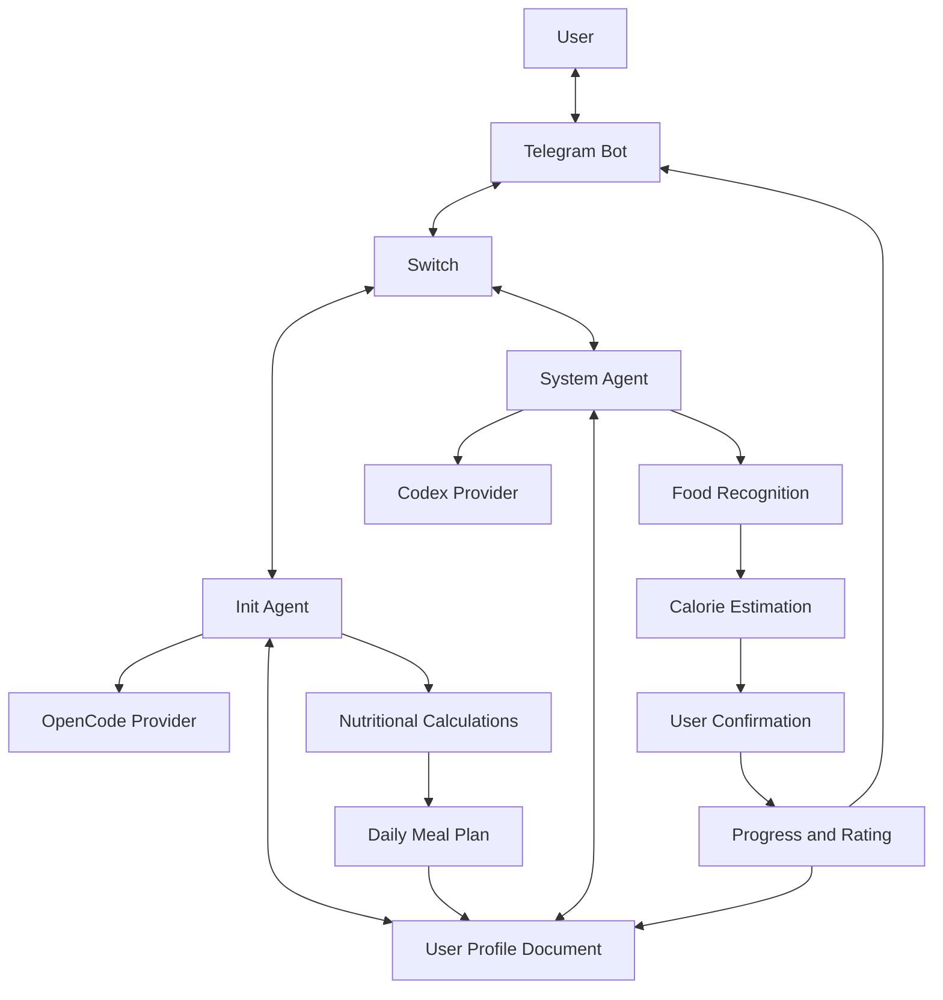

# AI Healthcare Assistant

A Telegram-based AI healthcare assistant that helps users manage their daily calorie intake, track meals, and monitor their progress toward healthier eating habits.

The project uses **Switch** to coordinate two specialized AI agents with separate responsibilities: one manages personal information and nutritional planning, while the other handles food recognition, calorie tracking, and daily progress.

---

## 1. Project Overview

The AI Healthcare Assistant provides users with a personalized daily calorie plan based on their personal information, activity level, and BMI.

After completing the initial setup, users can interact with the Telegram bot by sharing pictures of their meals. The assistant identifies the food, estimates its calories, and tracks the user's daily consumption. It also provides suggestions to help users stay within their recommended calorie targets.

### Main Features

- **Personal Profile:** Collects and maintains user information, including name, gender, age, height, weight, work type, and preferred meal times.
- **BMR Calculation:** Calculates Basal Metabolic Rate using personal information.
- **Daily Calorie Estimation:** Estimates daily energy requirements according to activity level.
- **BMI Calculation:** Classifies BMI and adjusts calorie recommendations accordingly.
- **Meal Distribution:** Divides daily calorie requirements into three main meals and three snacks.
- **Food Recognition:** Identifies food from pictures and estimates its calorie content.
- **Meal Evaluation:** Compares consumed calories with the recommended allowance.
- **Meal Improvement:** Suggests adjustments when a meal exceeds its recommended calories.
- **Progress Rating:** Tracks daily progress through a rating system ranging from 0% to 100%.
- **Activity Tracking:** Estimates calories burned through walking and incorporates them into the progress rating.
- **Profile Persistence:** Stores user information in a Switch room document and updates it when necessary.

## 2. AI Agents

The application consists of two agents connected through Switch. Each agent has a dedicated role and uses a different provider.

### Init – Personal Profile and Nutrition Agent

**Provider:** OpenCode

Init handles the initial user interaction and nutritional planning.

Responsibilities:

1. Greets new users and collects their personal information.
2. Requests name, gender, age, height, weight, work type, and preferred breakfast, lunch, and dinner times.
3. Provides two work-type choices:
   - **Desk Work:** Office work, studying, programming, and other activities involving long periods of sitting.
   - **Physical Work:** Construction, manual labor, and other jobs involving regular physical activity.
4. Saves the information and avoids repeating onboarding questions unless the user requests an update.
5. Calculates BMR and estimated daily calorie requirements.
6. Calculates BMI and adjusts calorie recommendations according to the result.
7. Divides daily calories into three main meals and three snacks.
8. Creates and maintains a `user-profile` document in the Switch room.

### System – Food Tracking and Progress Agent

**Provider:** Codex

System handles food recognition, meal evaluation, and daily progress tracking.

Responsibilities:

1. Receives food pictures from users and identifies the food.
2. Uses the provided food name when available. Otherwise, it estimates the food identity and requests confirmation.
3. Estimates the calories of identified food.
4. Confirms the identification and calorie estimation before recording a meal.
5. Suggests meal improvements when necessary.
6. Allows users to accept suggestions or keep their original meal.
7. Records the final confirmed meal and updates the remaining calorie allowance.
8. Maintains a progress rating between 0% and 100%.
9. Suggests walking when users exceed their recommended meal calories.
10. Estimates calories burned based on the user's profile and reported walking duration.
11. Updates the rating according to food consumption and physical activity.

## 3. Nutritional Calculations

### Basal Metabolic Rate (BMR)

The system uses the following formula:

```
BMR = 10 × weight(kg)
    + 6.25 × height(cm)
    - 5 × age(years)
    + 5
```

The formula above is the male version of the Mifflin-St Jeor equation. Gender-specific calculations should be used when implementing the female version.

### Daily Calorie Requirements

Daily calorie requirements are estimated using the activity multiplier:

```
Daily Calories = BMR × Activity Level
```

| Work Type | Activity Multiplier |
|---|---:|
| Desk Work | 1.2 |
| Physical Work | 1.55 |

### Body Mass Index (BMI)

BMI is calculated using:

```
BMI = weight(kg) / height(m)²
```

The system classifies adult BMI results as follows:

| BMI | Classification |
|---|---|
| Below 18.5 | Underweight |
| 18.5 – 24.9 | Normal weight |
| 25 – 29.9 | Overweight |
| 30 or above | Obesity |

The daily calorie target is adjusted according to the classification:

- Underweight: Increase calorie intake.
- Normal weight: Maintain estimated daily requirements.
- Overweight: Apply a moderate calorie deficit.
- Obesity: Apply a calorie deficit.

These classifications are general adult screening guidelines, not medical diagnoses. The system should not prescribe aggressive calorie restrictions.

### Meal Distribution

The daily calorie target is divided into six portions.

**Main Meals**

Two-thirds of daily calories are allocated to breakfast, lunch, and dinner:

```
Calories per Main Meal = (Daily Calories × 2/3) / 3
```

**Snacks**

One-third of daily calories is allocated to three snacks:

```
Calories per Snack = (Daily Calories × 1/3) / 3
```

## 4. Progress Rating System

The system maintains a daily rating between 0% and 100%, starting at 0%.

The rating reflects how closely the user follows the recommended calorie plan.

### Rating Rules

- Following the recommended meal allowance increases the rating.
- Exceeding the recommended meal allowance decreases the rating.
- Physical activity can increase the rating according to estimated calories burned.
- Rating changes are calculated proportionally to the user's total daily calorie requirement.
- The rating cannot exceed 100% or fall below 0%.

### Example

Assume the user's daily calorie requirement is 2,000 calories.

- Exceeding a meal allowance by 400 calories represents 20% of the daily requirement, resulting in a 20-percentage-point deduction.
- Burning 200 calories through walking represents 10% of the daily requirement, resulting in a 10-percentage-point increase.

The rating is updated after each confirmed meal or recorded physical activity.

## 5. System Architecture

Telegram acts as the main user interface, while Switch coordinates communication between the two agents.



### Main Workflow

**Initial Setup**

1. User starts a conversation with the Telegram bot.
2. Init collects personal information and meal preferences.
3. Init calculates BMR, BMI, and estimated daily calorie requirements.
4. Daily calories are divided into main meals and snacks.
5. User information and nutritional calculations are saved in the `user-profile` document.

**Food Tracking**

1. User sends a picture of a meal.
2. System identifies the food and estimates its calories.
3. User confirms the food identification and calorie estimation.
4. System suggests improvements when the meal exceeds its recommended allowance.
5. User accepts the suggestions or keeps the original meal.
6. The final confirmed calorie amount is deducted from the remaining daily allowance.
7. The progress rating is updated.

**Physical Activity**

1. System suggests walking only when the user exceeds a meal's recommended calorie allowance.
2. User can accept the suggestion or report a different walking duration.
3. System estimates the calories burned.
4. The progress rating is updated accordingly.

## 6. Demo

The project is demonstrated through a Telegram bot.

### Demo Scenarios

**User Registration**
- Start a conversation with the bot.
- Provide personal information and preferred meal times.
- Receive personalized nutritional calculations.
- Verify the generated user profile.

**Food Recognition**
- Send a picture of a meal.
- Receive food identification and calorie estimation.
- Confirm the result before recording.

**Meal Improvement**
- Submit a meal that exceeds the recommended allowance.
- Receive suggestions to improve the meal.
- Accept or reject the suggestions.
- View the updated calorie balance and rating.

**Physical Activity**
- Receive a walking suggestion after exceeding a meal allowance.
- Report the walking duration.
- View estimated calories burned and the updated rating.

**Profile Management**
- Request changes to personal information.
- Verify that the stored profile is updated.

**Demo Video:** [Add demo video link here]

**Screenshots:** [Add screenshots here]

## 7. Technologies Used

| Technology | Purpose |
|---|---|
| Telegram Bot | User interaction and notifications |
| Switch | Agent coordination and room management |
| OpenCode | Provider powering the Init agent |
| Codex | Provider powering the System agent |
| AI Vision | Food identification from pictures |
| Switch Room Documents | Persistent user profile storage |

## 8. Installation and Setup

### Prerequisites

- A Telegram bot created through BotFather.
- A configured and running Switch server.
- OpenCode configured as an agent provider.
- Codex configured as an agent provider.
- Access to the required AI models and services.

### Setup

1. Clone the repository:

```bash
git clone https://github.com/USERNAME/PROJECT.git
cd PROJECT
```

2. Configure your Telegram bot and connect it to Switch.

3. Configure the two agents:
   - `init` using the OpenCode provider.
   - `system` using the Codex provider.

4. Configure each agent with its respective responsibilities and instructions.

5. Create a Switch room and connect both agents to it.

6. Ensure both agents can access the `user-profile` room document.

7. Start the Switch server and activate the Telegram integration.

8. Open the Telegram bot and start interacting with the assistant.

### Usage

On the first interaction, Init handles user registration and creates the nutritional profile.

After the initial setup, users can share food pictures with the bot to track their meals, receive suggestions, and monitor their daily progress.

## 9. Important Notes

- Calorie estimates and food recognition results are approximate.
- Food must be confirmed before it is recorded.
- BMI is a general screening measurement and does not replace professional medical assessment.
- The assistant is an AI tool, not a doctor or dietitian.
- Users should consult a qualified healthcare professional before making significant dietary changes.

## 10. Team

**Project Contributors:**

- [Add team member names and GitHub profiles]

---

Built for the **Flip the Switch Hackathon** by WeMakeDevs.
