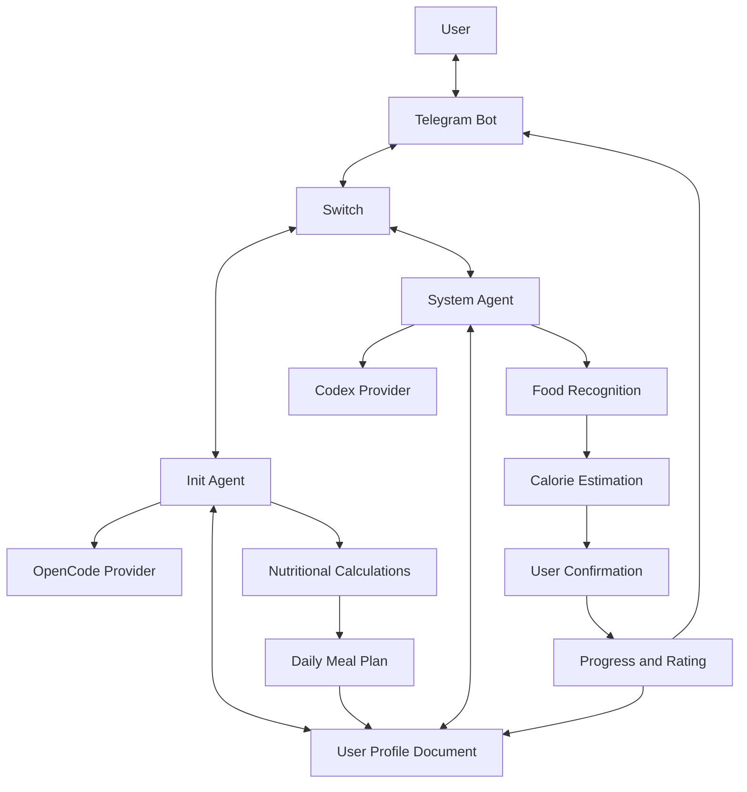

# AI Healthcare Assistant

An AI-powered healthcare assistant built for Telegram that helps users manage their daily calorie intake, track meals, and monitor their progress toward healthier eating habits.

The project uses **Switch** to coordinate two specialized AI agents with different responsibilities. One manages personal information and nutritional planning, while the other handles food recognition, calorie tracking, and daily progress.

---

## 1. Project Overview

The AI Healthcare Assistant provides users with a personalized daily calorie plan based on their personal information, gender, age, weight, height, and activity level.

Through a Telegram bot, users can share pictures of their meals, receive calorie estimates, track their daily consumption, and get suggestions to improve their eating habits.

### Features

- **Personalized Profiles:** Collects and maintains personal information and preferred meal times.
- **BMR Calculation:** Calculates Basal Metabolic Rate using gender-specific formulas.
- **Daily Calorie Estimation:** Estimates daily energy requirements based on activity level.
- **BMI Calculation:** Classifies Body Mass Index and adjusts calorie recommendations accordingly.
- **Meal Planning:** Divides daily calorie requirements into three main meals and three snacks.
- **Food Recognition:** Identifies food from pictures and estimates its calorie content.
- **Meal Evaluation:** Compares consumed calories with recommended meal allowances.
- **Meal Improvement:** Suggests adjustments to help users stay within their calorie targets.
- **Progress Rating:** Tracks daily progress through a rating system from 0% to 100%.
- **Activity Tracking:** Estimates calories burned through walking and incorporates them into the progress rating.
- **Profile Management:** Maintains user information in a persistent Switch room document.

## 2. AI Agents

The system consists of two specialized AI agents connected through Switch, each powered by a different provider.

### Init – Personal Profile and Nutrition Agent

**Provider:** OpenCode

Init is responsible for the user's initial setup and nutritional planning.

Its responsibilities include:

- Greeting new users and collecting their personal information.
- Collecting name, gender, age, height, weight, work type, and preferred breakfast, lunch, and dinner times.
- Providing two work-type options:
  - **Desk Work:** Office work, studying, programming, and other activities involving long periods of sitting.
  - **Physical Work:** Construction, manual labor, and other jobs involving regular physical activity.
- Avoiding repeated onboarding questions unless the user requests an update.
- Calculating BMR and estimated daily calorie requirements.
- Calculating BMI and adjusting calorie recommendations according to the result.
- Dividing daily calories into three main meals and three snacks.
- Creating and maintaining a `user-profile` document in the Switch room.

### System – Food Tracking and Progress Agent

**Provider:** Codex

System handles food recognition, meal evaluation, and daily progress tracking.

Its responsibilities include:

- Identifying food from user-submitted pictures.
- Using the provided food name or estimating it when no name is provided.
- Obtaining user confirmation before recording food.
- Estimating the calorie content of identified food.
- Suggesting meal improvements when the meal exceeds its recommended calorie allowance.
- Allowing users to accept suggestions or keep their original meal.
- Recording the final confirmed meal and updating the remaining daily calorie allowance.
- Maintaining a progress rating between 0% and 100%.
- Suggesting physical activity when users exceed their recommended meal calories.
- Estimating calories burned based on the user's profile and reported walking duration.
- Updating the progress rating according to food consumption and physical activity.

## 3. Nutritional Calculations

### Basal Metabolic Rate (BMR)

The assistant calculates BMR using the Mifflin-St Jeor equation, taking the user's gender into account.

**Male:**

```
BMR = (10 × Weight) + (6.25 × Height)
      - (5 × Age) + 5
```

**Female:**

```
BMR = (10 × Weight) + (6.25 × Height)
      - (5 × Age) - 161
```

Where:
- Weight is measured in kilograms.
- Height is measured in centimeters.
- Age is measured in years.

### Daily Calorie Requirements

Daily calorie requirements are estimated using the user's activity level:

```
Daily Calories = BMR × Activity Multiplier
```

| Work Type | Activity Multiplier |
|---|---:|
| Desk Work | 1.2 |
| Physical Work | 1.55 |

### Body Mass Index (BMI)

BMI is calculated using the user's weight and height:

```
BMI = Weight (kg) / Height (m)²
```

The assistant uses the following adult BMI classifications:

| BMI Range | Classification |
|---|---|
| Below 18.5 | Underweight |
| 18.5 – 24.9 | Normal Weight |
| 25 – 29.9 | Overweight |
| 30 or above | Obesity |

Based on the calculated BMI, the assistant adjusts the calorie target:

- **Underweight:** Increase calorie intake.
- **Normal Weight:** Maintain estimated daily calorie requirements.
- **Overweight:** Apply a moderate calorie deficit.
- **Obesity:** Apply a calorie deficit.

### Meal Distribution

The daily calorie target is divided into three main meals and three snacks.

**Main Meals:**

```
Calories per Meal = (Daily Calories × 2/3) / 3
```

**Snacks:**

```
Calories per Snack = (Daily Calories × 1/3) / 3
```

This distribution provides users with a daily calorie allowance for each meal and snack.

## 4. Progress Rating System

The assistant maintains a daily progress rating between 0% and 100%, starting at 0%.

The rating reflects how closely the user follows the recommended calorie plan.

### Rating Rules

- Following recommended meal allowances increases the rating.
- Exceeding recommended meal allowances decreases the rating.
- Physical activity increases the rating according to estimated calories burned.
- Rating changes are calculated proportionally to the user's total daily calorie requirements.
- The rating cannot exceed 100% or fall below 0%.

### Example

Assume the user's daily calorie requirement is 2,000 calories.

- Exceeding a meal allowance by 400 calories represents 20% of the daily requirement, resulting in a 20-percentage-point deduction.
- Burning 200 calories through walking represents 10% of the daily requirement, resulting in a 10-percentage-point increase.

The rating is updated after confirmed meals and recorded physical activities.

## 5. System Architecture

Telegram serves as the main communication interface, while Switch coordinates the two AI agents.



### Main Workflow

**Initial Setup and Nutritional Planning**

1. The user starts a conversation with the Telegram bot.
2. Init collects personal information and preferred meal times.
3. Init calculates BMR, BMI, and estimated daily calorie requirements.
4. Daily calories are divided into main meals and snacks.
5. The information is saved in the `user-profile` document.

**Food Tracking**

1. The user sends a picture of a meal.
2. System identifies the food and estimates its calories.
3. The user confirms the identification and calorie estimation.
4. System suggests improvements when necessary.
5. The user accepts the suggestions or keeps the original meal.
6. The final confirmed calorie amount is deducted from the remaining daily allowance.
7. The progress rating is updated.

**Physical Activity**

1. System suggests walking when the user exceeds a meal's recommended calorie allowance.
2. The user can accept the suggestion or report a different walking duration.
3. System estimates the calories burned.
4. The progress rating is updated accordingly.

## 6. Demo

The project is demonstrated through a Telegram bot, covering the complete process from user registration to daily food tracking.

### Demo Scenarios

**User Registration**
- Start a conversation with the bot.
- Provide personal information and preferred meal times.
- Receive personalized nutritional calculations.
- View the generated user profile.

**Food Recognition**
- Send a picture of a meal.
- Receive food identification and calorie estimation.
- Confirm the result before recording it.

**Meal Improvement**
- Submit a meal that exceeds the recommended allowance.
- Receive suggestions to improve the meal.
- Accept or reject the suggestions.
- View the updated calorie balance and rating.

**Physical Activity**
- Receive a walking suggestion after exceeding a meal allowance.
- Report the walking duration.
- View estimated calories burned and the updated rating.

**Profile Management**
- Request an update to personal information.
- Verify that the stored profile reflects the changes.

**Demo Video:** [Add demo video link]

**Screenshots:** [Add screenshots or a link to the screenshots directory]

## 7. Technologies Used

| Technology | Purpose |
|---|---|
| Telegram Bot | User interaction |
| Switch | Agent coordination and room management |
| OpenCode | Provider powering the Init agent |
| Codex | Provider powering the System agent |
| AI Vision | Food identification from pictures |
| Switch Room Documents | Persistent user profile storage |

## 8. Getting Started

### Prerequisites

- A Telegram bot created through BotFather.
- A configured and running Switch server.
- OpenCode configured as an agent provider.
- Codex configured as an agent provider.
- Access to the required AI models and services.

### Setup

1. Clone the repository:

```bash
git clone https://github.com/USERNAME/PROJECT.git
cd PROJECT
```

2. Configure your Telegram bot and connect it to Switch.

3. Configure the two agents:
   - `init` using the OpenCode provider.
   - `system` using the Codex provider.

4. Configure each agent with its respective responsibilities.

5. Create a Switch room and connect both agents to it.

6. Ensure both agents can access the `user-profile` room document.

7. Start the Switch server and activate the Telegram integration.

8. Open the Telegram bot and start interacting with the assistant.

### Usage

On the first interaction, Init handles user registration and creates the nutritional profile.

After the initial setup, users can share food pictures with the bot to track their meals, receive suggestions, and monitor their daily progress.

## 9. Disclaimer

This assistant provides AI-generated nutritional estimates and general wellness guidance. Food calorie estimations and BMI classifications may not always be accurate. It is not a substitute for professional medical advice. Users should consult a qualified healthcare professional before making significant dietary changes.

---

**Built for the Flip the Switch Hackathon by WeMakeDevs.**
